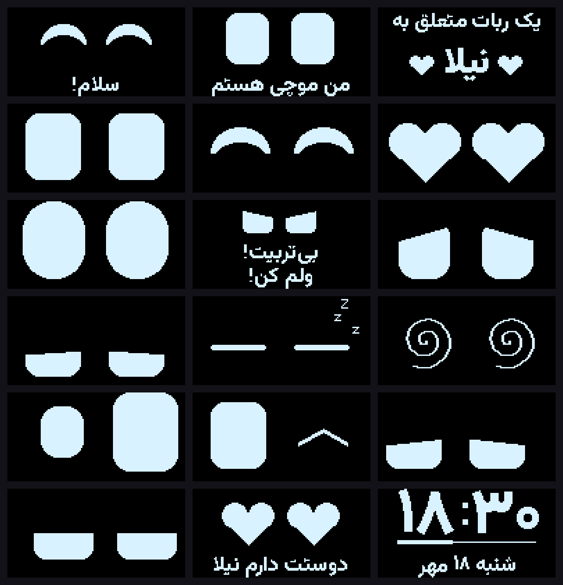

# موچی ۲ — ربات کوچولوی عاشق

[English](README.md) · **فارسی**

برد: **ESP32-C3 Super Mini** · OLED ۱٫۳ اینچ · ماژول ساعت · ۳ تاچ · کلید جیوه‌ای · بلندگو · یک LED WS2812 (قلب)



## سیم‌بندی (در `src/config.h` قابل تغییر)

| قطعه | پایه |
|---|---|
| OLED و ماژول ساعت (I2C) | SDA = GPIO6 ، SCL = GPIO7 |
| LED قلب WS2812 | GPIO4 |
| بلندگو | GPIO5 |
| تاچ بالا | GPIO0 |
| تاچ چپ | GPIO1 |
| تاچ راست | GPIO2 |
| کلید جیوه‌ای | GPIO10 |

## مراحل

1. **بکاپ برنامه‌ی فعلی** — `1-backup-firmware.bat` را دوبار کلیک کن.
   کل حافظه‌ی برد در `backup\moochi-old-full.bin` ذخیره می‌شود و متن‌های داخلش در `backup\moochi-old-strings.txt`.
   هر وقت خواستی برنامه‌ی قدیمی برگردد: `2-restore-old-firmware.bat`.
   > برنامه‌ای که روی برد است «کامپایل‌شده» است؛ با بکاپ می‌شود آن را عیناً برگرداند ولی نمی‌شود دوباره به کد قابل ویرایش تبدیلش کرد.
2. **رمزها:** `src/secrets.example.h` را کپی کن به `src/secrets.h` و اسم و رمز وای‌فای ، کد بات (`PAIR_CODE`)، اسم‌ها (`OWNER_NAME` و `FRIEND_NAME`)، تولد و بقیه را بنویس.
   برای آپلود بی‌سیم `secrets.example.ini` را هم کپی کن به `secrets.ini`. این دو فایل هیچ‌وقت روی گیت‌هاب نمی‌روند.
3. این پوشه را در VS Code باز کن (PlatformIO) و **Upload** بزن.
   اگر آپلود شروع نشد: دکمه‌ی BOOT را نگه دار، RST را بزن، BOOT را ول کن، دوباره Upload.
4. **تنظیم ساعت** — اولین بار ساعت از زمان کامپایل تنظیم می‌شود. برای تنظیم دقیق: Serial Monitor را ببند و `3-set-clock.bat` را اجرا کن.

## رفتارها

| کار تو | واکنش موچی |
|---|---|
| روشن شدن | «سلام! من موچی هستم — یک ربات متعلق به ‹اسم صاحبش› ❤» |
| یک ضربه به تاچ بالا | ساعت و تاریخ شمسی ↔ برگشت به چشم‌ها |
| دو ضربه‌ی پشت‌سرهم بالا | چشم قلبی + جمله‌ی عاشقانه |
| نگه داشتن بالا / چپ / راست | ناز کردن: چشم خندان و خرخر |
| تاچ چپ یا راست | به همان طرف نگاه می‌کند، می‌خندد یا چشمک می‌زند |
| چپ و راست با هم | بغل! چشم قلبی |
| تند تند دست زدن | «بسه دیگه!» |
| ضربه‌ی کوچک | غافلگیر: «وای!» |
| **تکان شدید** | عصبانی، LED قرمز، غرغر و بد و بیراه |
| چند بار تکان پشت‌سرهم | گیج می‌شود و بعد **قهر** می‌کند — با ناز کردن آشتی می‌کند |
| کج نگه داشتن | «کجم کردی!» |
| بی‌کاری | خواب‌آلود و بعد خواب (zZz)؛ شب‌ها زودتر و صفحه کم‌نورتر |
| صبح، اولین لمس | «صبح بخیر ‹اسم›!» |
| هر چند دقیقه | یک جمله‌ی عاشقانه |
| سر هر ساعت (۸ تا ۲۲) | صدای کوچک و نمایش ساعت |

LED قلب با هر حالت رنگ و ضربان خودش را دارد (صورتی آرام، قرمز تند موقع عصبانیت، بنفش موقع خواب...).

## نسخه‌ی ۳: اینترنت ، بازی‌ها ، پیام از راه دور

> بعد از این نسخه ، **اولین آپلود حتما با کابل** باشد (تقسیم‌بندی حافظه عوض شده). از آن به بعد بی‌سیم هم می‌شود.

### صفحه‌ی تنظیمات
وقتی موچی به وای‌فای وصل شد ، روی گوشی یا کامپیوتری که به همان وای‌فای وصل است برو به **http://moochi.local**
(اگر باز نشد: آی‌پی را با دستور `ip` در Serial Monitor یا در صفحه‌ی تست ببین).
آن‌جا: پیام فرستادن ، زنگ ساعت ، شهر و منطقه‌ی زمانی ، تولد و سالگرد ، اجرای بازی‌ها ، عوض کردن وای‌فای.

اگر وای‌فای پیدا نشد (مثلا در خانه‌ی جدید) ، موچی بعد از ۳۰ ثانیه خودش یک وای‌فای به اسم **Moochi** (رمز `moochi1234`) می‌سازد؛ به آن وصل شو و برو به **http://192.168.4.1** و وای‌فای جدید را بده.

### پیام از هر جای دنیا 💌
- **فرستادن:** در مرورگر برو به `https://ntfy.sh/<کانال>` (اسم کانال در `src/secrets.h` → `NTFY_TOPIC`) و پیام بنویس. یا در اپ **ntfy** (اندروید/آیفون) همان کانال را اضافه کن و پیام بفرست.
  - متن فارسی و انگلیسی و ایموجی (ایموجی‌ها قلب نشان داده می‌شوند) ؛ فقط `❤` یا `<3` = «‹اسم دوست› به یادته!» با چشم قلبی.
  - موچی هر ۲۰ ثانیه سر می‌زند. پیام نشان داده می‌شود و تا صاحبش لمسش نکند ، پاکت نامه گوشه‌ی صفحه چشمک می‌زند و هر ۱۰ دقیقه می‌گوید «یه پیام داری!».
- **خبرها برای تو:** در اپ ntfy کانال `<کانال>-back` را اضافه کن ؛ وقتی صاحبش موچی را **بغل کند** یا **پیامت را ببیند** خبردار می‌شوی.
- اگر ntfy.sh از جایی باز نشد ، شاید فیلتر باشد (با VPN امتحان کن).

### آپلود بی‌سیم (بدون باز کردن جعبه)
```powershell
& $pio run -e ota -t upload
```
(کامپیوتر و موچی روی یک وای‌فای باشند)

### چیزهای جدید
| | |
|---|---|
| ساعت خودکار | از اینترنت تنظیم می‌شود (و ماژول ساعت را هم درست می‌کند) |
| آب‌وهوا | در صفحه‌ی ساعت ، به نوبت با تاریخ (آیکن + دما) |
| روزهای خاص | تولد صاحبش (`BDAY_JM`/`BDAY_JD` در `secrets.h`) ، سالگرد (از صفحه‌ی تنظیمات) ، نوروز ، یلدا ، سپندارمذگان: جشن با کیک/قلب و آهنگ تولد. تا ۱۴ روز قبلش شمارش معکوس در صفحه‌ی ساعت |
| عشق‌سنج | با ناز و بغل پر می‌شود ، با تکان و بی‌توجهی کم. اگر خیلی کم شود می‌گوید «دلم گرفته... نازم کن!» |
| دلتنگی | اگر ۳ ساعت کسی سراغش نیاید: «کجا بودی؟! دلم برات تنگ شد» |
| زنگ ساعت | از صفحه‌ی تنظیمات. «پاشو ‹اسم›!» — تاچ بالا = ۵ دقیقه‌ی دیگر ، بغل یا نگه داشتن = خاموش |
| **منوی بازی‌ها** | چپ و راست را با هم **۲ ثانیه** نگه دار |

### منو (چپ/راست = قبلی/بعدی ، بالا = انتخاب ، نگه داشتن بالا = خروج از همه‌جا)
- **توپ جادویی:** سؤالت را بپرس و تکانش بده
- **تاس:** تکان بده یا لمس کن
- **بازی سرعت:** وقتی قلب آمد زود بزن (رکورد ذخیره می‌شود)
- **بازی حافظه:** ترتیب نور و صدای سه تاچ را تکرار کن
- **تایمر:** چپ/راست = کم/زیاد ، نگه داشتن کنار = ۵ یا ۲۵ دقیقه ، بالا = شروع/مکث
- **چراغ خواب:** LED گرم و آرام ؛ چپ/راست = کم‌نور/پرنور
- **عشق‌سنج**


## نسخه‌ی ۴: بات بله/تلگرام و قابلیت‌های تازه

### ساختن بات (یک بار)
1. در **بله** به `@botfather` پیام بده ← `/newbot` ← یک اسم (مثلا Moochi) و یک یوزرنیم که به `bot` ختم شود.
2. توکنی که می‌دهد را در صفحه‌ی تنظیمات موچی، بخش **بات بله / تلگرام** بچسبان و ذخیره کن.
3. در چت بات خودت بنویس: `/pair <کد>` (کد در `src/secrets.h` → `PAIR_CODE`). از این به بعد فقط تو می‌توانی با موچی حرف بزنی.

(تلگرام هم کار می‌کند ولی در ایران فیلتر است؛ موچی که در کانادا است مشکلی ندارد، کافی است «پیام‌رسان» را تلگرام بگذاری.)

| در بات بنویس | چه می‌شود |
|---|---|
| هر متنی | روی صفحه‌ی موچی + «یه پیام داری» ؛ وقتی دید خبرت می‌کند |
| `/love` یا ❤ | چشم‌های قلبی |
| `/status` | حال موچی، ساعت و هوای آن‌جا، عشق‌سنج، حال امروز صاحبش |
| `/fal` | فال حافظ برای صاحبش (بیتش برای تو هم می‌آید) |
| `/ask` | «امروز حالت چطوره؟» — جوابش برایت فرستاده می‌شود |
| `/music` یا `/music 3` | یک آهنگ از جعبه‌ی موسیقی |
| `/remind 21:30 قرصت یادت نره` | یادآور هر روزه با زنگوله ؛ `/reminders` لیست ، `/clear` پاک کردن |
| `/meet 2026-12-20` | شمارش معکوس دیدار در صفحه‌ی ساعت |
| `DOODLE:...` | نقاشی! در `tools/doodle.html` (صفحه‌ی «نقاشی برای موچی») بکش و متنش را کپی کن |

### چیزهای تازه روی خود موچی
- **منو:** فال حافظ ، جعبه‌ی موسیقی (۶ آهنگ) ، **جواب به دوست** (چپ/راست = انتخاب جمله‌ی آماده ، بالا = فرستادن)
- **حال امروز:** ساعت ۸ شب می‌پرسد «امروز حالت چطوره؟» — چپ = بد ، بالا = معمولی ، راست = خوب
- **صفحه‌ی ساعت:** به نوبت ساعت دوست (تهران) و روزهای مانده تا دیدار
- **امتیاز محبت:** با ناز و بغل جمع می‌شود؛ ۴۰ = پاپیون ، ۱۵۰ = گل ، ۴۰۰ = تاج روی سرش
- قلب‌های شناور وقتی عاشق است، و گاهی **عطسه** می‌کند!
- در صفحه‌ی تنظیمات: نقاشی مستقیم، روز دیدار، یادآورها، تنظیم بات

## اسم‌ها

موچی صاحبش را به اسم صدا می‌زند و از یک «دوست» (کسی که پیام می‌فرستد) اسم می‌برد. روی گیت‌هاب اسم‌های نمونه‌ی «نیلا» و «آرش» هستند.

- متن‌های داخل برنامه و بات: `OWNER_NAME` و `FRIEND_NAME` در `src/secrets.h`.
- جمله‌های آماده و صدا: `tools/names.example.json` را کپی کن به `tools/names.json` ، اسم‌ها را بنویس و `make_text.py` و `make_voice.py` را اجرا کن.
  با بودن `names.json` خروجی در `src/moochi_text_personal.h` و `src/moochi_voice_personal.h` ساخته می‌شود؛ برنامه خودش از آن‌ها استفاده می‌کند و هیچ‌وقت روی گیت‌هاب نمی‌روند.

## حرف زدن 🔊

موچی هر جمله‌ای را که روی صفحه می‌نویسد با صدای دختربچه هم می‌گوید (بلندگوی GPIO5).
صدای فعلی رباتی است (eSpeak). برای صدای طبیعی‌تر روی کامپیوتر خودت بساز:

```powershell
& $py -m pip install miniaudio edge-tts
& $py tools\make_voice.py --engine edge
```

- بچه‌گانه‌تر: `--shift 1.3` ؛ عادی‌تر: `--shift 1.0` ؛ زیرتر: `--pitch +90Hz`
- **صدای واقعی خودت یا یک بچه:** فایل را با اسم کلید جمله در `tools\voice\` بگذار (مثلا `tools\voice\LOVE1.mp3`) و دوباره `make_voice.py` را اجرا کن. اسم کلیدها در `tools\make_text.py` است.
- بلندی: `VOICE_VOLUME` در `src/config.h` ؛ خاموش کردن حرف زدن: `VOICE_ON 0` ؛ تست: `say 4` در Serial Monitor

### بلندتر کردن صدا (سخت‌افزاری)
پایه‌ی ESP32 حداکثر ~۴۰ میلی‌آمپر می‌دهد و بلندگو را ضعیف می‌راند. یکی از این دو:

**الف) یک ترانزیستور (ارزان‌ترین):** ماسفت AO3400 / 2N7000 یا ترانزیستور S8050 / BC337 / 2N2222
```
5V ──── بلندگو(+) ── بلندگو(−) ──┬── Drain (یا Collector)
                                 │
   دیود 1N4148 موازی بلندگو (خط دیود سمت 5V)
GPIO5 ── مقاومت 1k ── Gate (یا Base)
GND ─────────────────────────── Source (یا Emitter)
```
**ب) ماژول آمپلی‌فایر PAM8403 (بلندتر و تمیزتر):**
`GPIO5 → مقاومت 1k → L-in` ، `GND → GND` ، `5V → VCC` ، بلندگو به `L+ / L−` (هیچ‌کدام به GND وصل نشود).

## عوض کردن جمله‌ها

جمله‌ها در `tools/make_text.py` هستند. بعد از تغییر:

```
%USERPROFILE%\.platformio\penv\Scripts\python.exe -m pip install pillow
%USERPROFILE%\.platformio\penv\Scripts\python.exe tools\make_text.py
```

و دوباره Upload. (فونت: وزیرمتن، در `tools/fonts`)
اگر جمله‌ی جدید اضافه کردی ، `make_voice.py` را هم اجرا کن تا صدایش ساخته شود.

## اگر چیزی درست کار نکرد

| مشکل | راه‌حل در `src/config.h` |
|---|---|
| تصویر جابه‌جا یا برفکی است | `OLED_IS_SSD1306 1` |
| تصویر برعکس است | `OLED_FLIP 1` |
| تاچ‌ها همیشه لمس‌شده‌اند | `TOUCH_ACTIVE_HIGH 0` |
| تکان کم هم عصبانی‌اش می‌کند | `SHAKE_EDGES_HARD` را بیشتر کن (مثلاً ۱۴) |
| تکان شدید هم عصبانی‌اش نمی‌کند | `SHAKE_EDGES_HARD` را کمتر کن (مثلاً ۶) |
| رنگ LED اشتباه است | `LED_IS_RGB_ORDER 1` |
| صدا زیاد/کم است | `SOUND_VOLUME` |

**صفحه‌ی تست:** موقع روشن کردن، تاچ بالا را نگه دار ← وضعیت همه‌ی تاچ‌ها، کلید جیوه‌ای و ساعت نمایش داده می‌شود (نگه داشتن بالا = خروج).

**دستورهای Serial Monitor:** `help` ، `ip` ، `time 2026-10-10 18:30:00` ، `mood angry` ، `clock` ، `diag` ، `shake` ، `hug` ، `menu` ، `alarm` ، `party` ، `app 3` ، `msg سلام` ، `boot` ، `ask` ، `fal` ، `note متن` ، `sneeze` ، `xp 200`

> اگر بلندگو در واقع یک «بازر فعال» باشد (فقط یک صدای بیب ثابت دارد)، نُت‌ها همه یک‌جور شنیده می‌شوند — برای ملودی، بازر پسیو یا بلندگوی کوچک لازم است.

## مجوز

کد: [MIT](LICENSE) · فونت وزیرمتن: [SIL OFL](tools/fonts/OFL.txt) · غزل‌های حافظ و ملودی‌ها: مالکیت عمومی.
