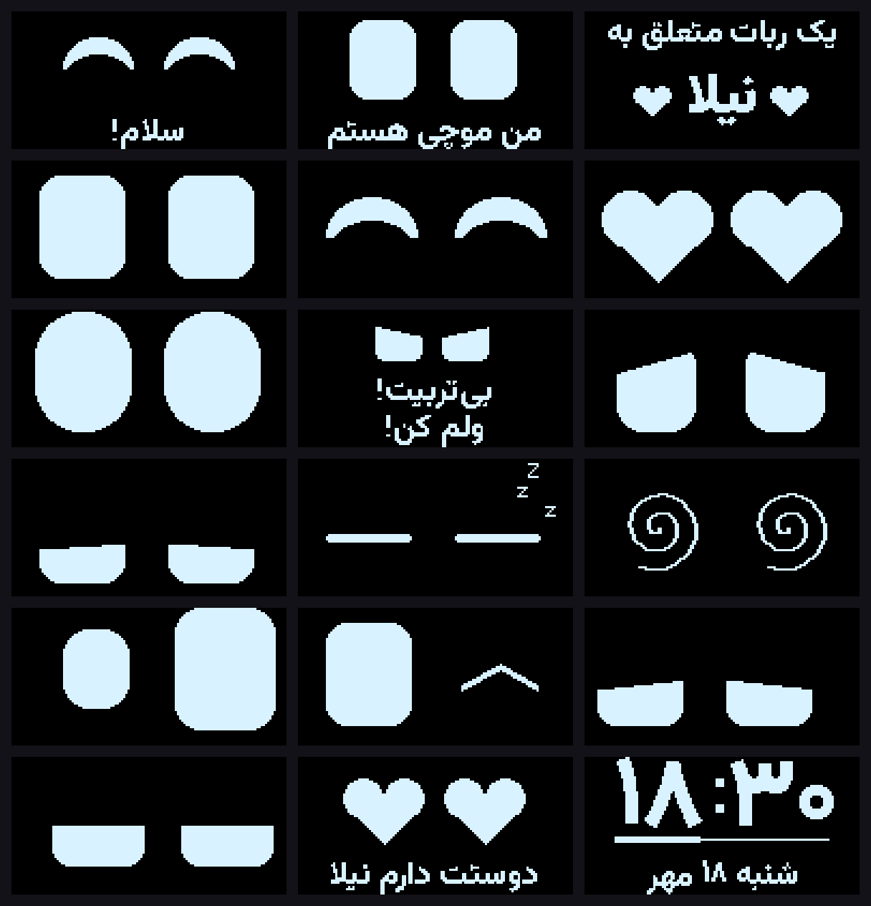
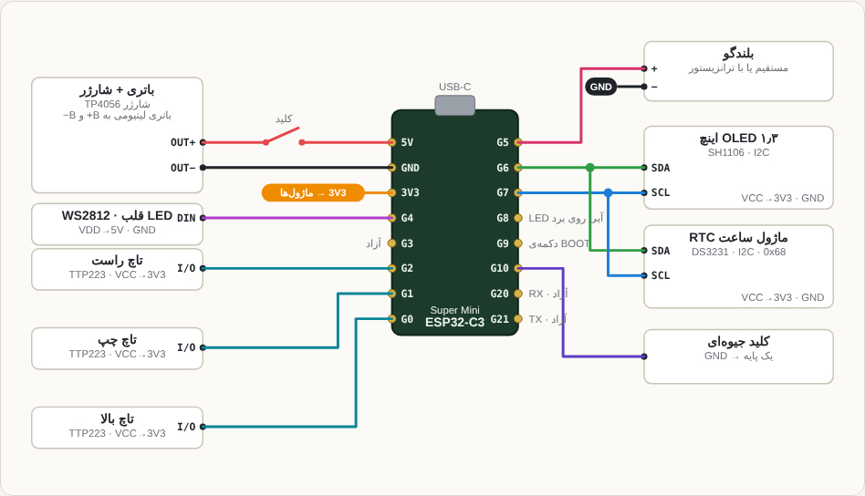

# Moochi 2 — a tiny love robot

**English** · [فارسی](README.fa.md)

Moochi is a palm-sized desk companion, made as a gift for someone special. It has big animated eyes, reacts to touch and shaking, speaks Persian in a little girl's voice, shows the clock, the weather and the Persian (Jalali) date, and lets someone far away send messages, drawings and reminders to it through a Bale or Telegram bot.



## Hardware

| Part | Pin |
|---|---|
| ESP32-C3 Super Mini | — |
| 1.3" OLED (SH1106 or SSD1306) + DS3231/DS1307 RTC, on I2C | SDA = GPIO6, SCL = GPIO7 |
| WS2812 RGB LED (the "heart") | GPIO4 |
| Small speaker or passive buzzer | GPIO5 |
| TTP223 touch pad — top | GPIO0 |
| TTP223 touch pad — left | GPIO1 |
| TTP223 touch pad — right | GPIO2 |
| Mercury tilt switch | GPIO10 |
| Li-ion battery + charger | — |

Every pin and behaviour knob is in [`src/config.h`](src/config.h).

Wiring diagram, perfboard layout and pin table: [`docs/wiring.html`](docs/wiring.html) (open it in a browser).



## Build and upload

1. Install VS Code with the PlatformIO extension.
2. Copy `src/secrets.example.h` to `src/secrets.h` and fill in your Wi-Fi name and password, the bot pairing code (`PAIR_CODE`), the two names (`OWNER_NAME`, `FRIEND_NAME`), the birthday and the other values. For wireless uploads, also copy `secrets.example.ini` to `secrets.ini`. Both files are git-ignored.
3. Open this folder in VS Code and press **Upload**. If the upload does not start: hold BOOT, tap RST, release BOOT and try again.
4. After the first cable upload you can upload over Wi-Fi: `pio run -e ota -t upload`.
5. Optional: run `3-set-clock.bat` (Serial Monitor closed) to set the RTC precisely. Moochi also syncs the time over the internet.

Before the first upload, `1-backup-firmware.bat` saves the board's current firmware to `backup\` and `2-restore-old-firmware.bat` puts it back.

## What it does

| You do | Moochi does |
|---|---|
| Power on | Greets: "Hi, I'm Moochi, a robot that belongs to <owner> ❤" |
| Tap top | Clock + Jalali date, weather, countdowns ↔ back to the eyes |
| Double-tap top | Heart eyes and a love note |
| Hold any pad | Purrs and smiles |
| Tap left / right | Looks that way, giggles or winks |
| Hold left + right | Hug (heart eyes); keep holding 2 s to open the **menu** |
| Shake hard | Gets angry, red LED, grumbles; shake again and it sulks until you pet it |
| Tilt | Gets dizzy |
| Leave it alone | Gets sleepy, then sleeps (earlier at night, with a dimmer screen) |

The heart LED changes colour and beat with each mood.

**Menu** (left/right = previous/next, top = open, hold top = exit from anywhere): magic 8-ball, dice, reaction game, Simon memory game, timer, night light, love meter, Hafez fortune (فال حافظ), music box, quick replies to the sender.

**Other features**

- Web settings page at `http://moochi.local` (or the IP shown on screen): send messages, alarm clock, city and time zone, birthday and anniversary, games, Wi-Fi, bot token, meeting date, daily reminders, and a drawing canvas.
- If Wi-Fi is not found it opens its own hotspot `Moochi` (password from `AP_PASS`) at `http://192.168.4.1`.
- Special days (birthday, anniversary, Nowruz, Yalda, Sepandarmazgan) with a party animation, and countdowns on the clock screen.
- Every evening it asks "How was your day?" (left = bad, top = so-so, right = good) and reports the answer to the bot owner.
- Love points grow with petting and hugs and unlock a bow, a flower and a crown.

## Bale / Telegram bot

1. In Bale (or Telegram) message `@botfather`, send `/newbot` and copy the token.
2. Paste the token into the **Bale / Telegram bot** section of the settings page and save.
3. In your bot's chat send `/pair <PAIR_CODE>`. From then on only you can talk to Moochi.

| Send | Result |
|---|---|
| Any text | Shown on Moochi's screen; you are told when it has been read |
| `/love` or ❤ | Heart eyes |
| `/status` | Moochi's mood, local time and weather, love meter, today's mood answer |
| `/fal` | A Hafez fortune for the owner (the verse is sent to you too) |
| `/ask` | Asks "How was your day?" now |
| `/music` or `/music 3` | Plays a song from the music box |
| `/remind 21:30 text` | Daily reminder; `/reminders` lists them, `/clear` removes them |
| `/meet 2026-12-20` | Countdown to the next meeting on the clock screen |
| `/names Nila Arash` | Change the names |
| `DOODLE:...` | A drawing — make one with [`tools/doodle.html`](tools/doodle.html) and paste the text |

Telegram is blocked in Iran; Bale works there. ntfy.sh is also supported (`NTFY_ON` in `config.h`).

## Names

The robot speaks to its owner by name and mentions a friend (the person who sends messages). The repository ships with the example names «نیلا» (Nila) and «آرش» (Arash).

**Change them any time without re-uploading:** in the web settings page (card «اسم‌ها»), from the bot with `/names <owner> <friend>`, or over serial with `names <owner> <friend>`. Sentences that contain a name are redrawn on the device right away. Their voice clips are muted until you regenerate the voice with the new names (below), since a recorded clip cannot change a word.

Defaults for a fresh board:

- `OWNER_NAME` and `FRIEND_NAME` in `src/secrets.h` (used until you set names from the web page).
- Pre-drawn sentences and the voice: copy `tools/names.example.json` to `tools/names.json`, put your names in it and run `python tools/make_text.py` and `python tools/make_voice.py`. With `names.json` present the tools write `src/moochi_text_personal.h` and `src/moochi_voice_personal.h`, which the firmware uses automatically and which are git-ignored, so your names never end up on GitHub.

## Voice

Every on-screen sentence also has a recorded voice clip (IMA-ADPCM, 8 kHz) in `src/moochi_voice.h`, played through a hardware timer. The default voice is generated with eSpeak NG using the girl voices in `tools/espeak_voices`. For a more natural voice, generate it with Microsoft Edge TTS on your PC:

```
python -m pip install miniaudio edge-tts
python tools/make_voice.py --engine edge
```

You can also drop your own recordings into `tools/voice/` named after the phrase key (for example `LOVE1.mp3`). Sample voices are in `voice-samples/`. To make the speaker louder, drive it through a small transistor or a PAM8403 amplifier (details in the Persian README).

## Changing the text

Fixed sentences are pre-rendered from the Vazirmatn font into bitmaps. Edit them in `tools/make_text.py`, then run:

```
python -m pip install pillow
python tools/make_text.py
python tools/make_voice.py
```

Free text (messages, fortunes, reminders) is shaped and drawn on the device by `src/persian_text.h`, with right-to-left layout and mixed Latin text.

## Troubleshooting

| Problem | Fix in `src/config.h` |
|---|---|
| Image shifted or noisy | `OLED_IS_SSD1306 1` |
| Image upside down | `OLED_FLIP 1` |
| Touch pads always pressed | `TOUCH_ACTIVE_HIGH 0` |
| Gets angry too easily / not at all | raise / lower `SHAKE_EDGES_HARD` |
| LED colours wrong | `LED_IS_RGB_ORDER 1` |

Diagnostics: hold the top pad while powering on. Serial commands (115200 baud): `help`, `ip`, `time 2026-10-10 18:30:00`, `mood angry`, `menu`, `alarm`, `party`, `msg hello`, `ask`, `fal`, `sneeze`.

## Project layout

```
src/        firmware (main.cpp, face, screens, Persian text, voice, web page)
tools/      generators for text bitmaps, font and voice; doodle page
voice-samples/   voice previews
```

## License

Code: [MIT](LICENSE). Vazirmatn font: [SIL OFL 1.1](tools/fonts/OFL.txt). Hafez poems and the folk/classical melodies are in the public domain.
